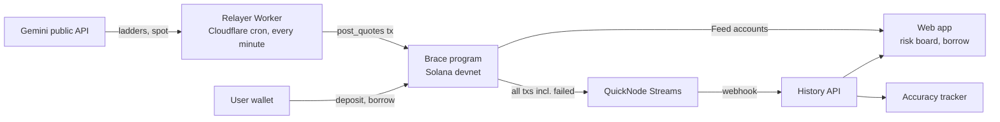

# Brace

**For judges:** TBD-post-build: open the live risk board (no wallet), then try a borrow above SOL's limit and watch Solana reject it.

<!-- TBD-post-build: one narrow screenshot of the live risk board, docs/images/board.png, ~260px, centered -->

**Gemini's prediction markets, turned into an onchain volatility oracle for Solana lending.**

Lending markets set loan-to-value limits by governance vote and rarely change them, so limits are still the calm-week numbers when volatility arrives. Brace reads Gemini's live "price X or above" ladders, computes implied volatility onchain on Solana, and tightens borrowing limits before the move. Limits never go above the 75% governance cap, stale data only ever lowers them, and odds never liquidate anyone.

- [Try it](#try-it) (TBD-post-build: live app link)
- [Proof it's real](#proof-its-real): program on devnet, live feeds, tests
- [Tracks](#tracks): DeFi & Onchain Apps, Best use of Solana, Gemini Prediction Markets, QuickNode Streams
- [How Gemini, Solana and QuickNode are used](#how-the-sponsor-tech-is-used)
- [Built during UBC 2026](#built-during-ubc-2026)

## Try It

TBD-post-build: written from the real on-screen words once the app is live. Planned shape:

1. Open the live board. No wallet, no signup. See implied volatility and the max LTV for SOL, BTC, ETH, XRP and ZEC, each updated within the last minute, with an explorer link to the transaction that set it.
2. With a devnet wallet (Phantom, Testnet Mode, Solana Devnet), deposit SOL and borrow test USD above SOL's limit. The transaction fails onchain with `RiskTightened`.
3. Borrow under the limit. It goes through. Both attempts appear in the history feed.

Check the code in one command (Rust and the Anchor CLI 1.2.2 required):

```bash
anchor build && cargo test -p brace
```

Expected: 52 tests pass (15 math, 12 adversarial, 1 fuzz run of 3,000 random actions, 12 oracle, 9 pool, 3 relayer-encoding). The fuzz run takes about a minute.

## Proof It's Real

- **Program on Solana devnet:** `Frv6CVJKADmkM2cnBSMKgBWPvtHsfYkfye5d4vB84WyC`. TBD-post-build: explorer link once deployed.
- **Live posts:** TBD-post-build: link to a `post_quotes` transaction whose logs show `brace SOL conf=1 sigma_bps=… max_ltv=…`.
- **History from QuickNode Streams:** TBD-post-build: `/history?asset=SOL` URL.
- **The math works on real Gemini data.** Captured ladders are test fixtures: a SOL ladder from Nov 16, 2026 fits onchain to 82.7% implied volatility and a 69.6% limit, matching an independent float reference ([`programs/brace/tests/oracle.rs`](programs/brace/tests/oracle.rs), [`src/math.rs`](programs/brace/src/math.rs) unit tests).
- **Reviewed five times** by separate reviewers, findings fixed with a test each ([`docs/reviews.md`](docs/reviews.md)).

## What's New Here

**Prediction markets used as risk infrastructure for the rest of DeFi, not as another betting app.**

Forward-looking volatility feeds today come from options markets, and Deribit, the largest crypto options venue, lists options on 7 coins (BTC, ETH, SOL, HYPE, XRP, AVAX, TRX; checked Nov 15, 2026). ZEC has no crypto options market. Gemini lists daily and hourly price ladders on it anyway.

- **The math runs onchain.** The relayer posts Gemini's raw bid and ask quotes; the program does the fit with integers only (probit lookup table, least squares, square roots). The relayer can't fake a volatility number.
- **Fail safe, not fail open.** Thin, stale or inconsistent data never loosens a limit: it holds, then steps down 2.5 points every 5 minutes. After an hour with no fresh data, borrowing and liquidation stop.
- **Odds never liquidate.** Liquidation uses only the fixed 80% threshold.
- **Real-time history.** QuickNode Streams delivers every program transaction, including failed borrows, to the history feed.

## Tracks

| Track | What fits | Where to check |
|---|---|---|
| DeFi & Onchain Apps | A lending risk primitive plus a working pool that enforces it | [`instructions/borrow.rs`](programs/brace/src/instructions/borrow.rs), Try It step 2 |
| Best use of Solana | Volatility math onchain in an Anchor program on devnet, about 66k compute units per post | [`src/math.rs`](programs/brace/src/math.rs), [`instructions/post_quotes.rs`](programs/brace/src/instructions/post_quotes.rs) |
| Gemini Prediction Markets | Gemini's live ladders are the only input to the oracle | [`worker/src/`](worker/src), [How Gemini is used](#how-the-sponsor-tech-is-used) |
| QuickNode Streams | Streams is the data source for the history, blocked-borrow feed and accuracy tracker | TBD-post-build: Task 9 |

## What Works Today

| Piece | State |
|---|---|
| Brace program (oracle, limits, pool, liquidation) | Built, 49 Rust tests pass; not yet on devnet |
| Relayer Worker (Cloudflare, every minute) | Built, 18 unit tests on live Gemini fixtures; encoding accepted by the program in 3 tests; not yet deployed |
| Streams sink and `/history` API | Not built yet |
| Web app (risk board, borrow flow) | Not built yet |
| Accuracy tracker (Python) | In progress by Alchin |

## How the Sponsor Tech Is Used

**Gemini Prediction Markets API**
- `GET /v1/prediction-markets/events?status=active&category=crypto`: the Worker picks, per asset, the earliest-expiring "above" ladder between 15 minutes and 72 hours out with at least 4 two-sided quotes, and sends up to 16 strikes with bid and ask in basis points.
- `GET /v1/pubticker/{solusd,…}`: spot price, checked onchain against the ladder's implied median (must be within 3%).
- Trading is US-only, so Brace uses public market data only.

**Solana**
- Anchor 1.2.2 program, PDAs for config, per-asset feeds, pool, positions and a test USD mint; SPL Token for the test USD.
- `post_quotes` fits the ladder onchain; `borrow` and `withdraw` check the live limit; failed borrows log `brace blocked ltv=… limit=…`.

**QuickNode Streams**
- TBD-post-build: stream config (Solana devnet, filtered to the program id), destination, and what the history API serves.

## How It Works



<details><summary><strong>The math, in short</strong></summary>

Each Gemini contract "price ≥ K at expiry" trades at a probability. Under a lognormal model, z = probit(P) is linear in x = ln(K/K_ref) with slope −1/(σ√T).

1. Keep quotes with both sides, spread ≤ 15 cents, mid between 3% and 97%; skip strikes more than 15% from the middle strike.
2. Least-squares fit gives σ√T and the implied median. The strikes must span at least 0.5%, and σ must be at least 5%.
3. Move over 24 hours: s = σ√T·√(24h/T). Limit = 80% × (1 − 3s), clamped between 30% and the 75% governance cap.
4. Stale data: hold the last limit for 5 minutes, then step down 2.5 points every 5 minutes, never below 50% (or the last limit if lower). After an hour, borrowing and liquidation pause.

</details>

## Security

Reviewed in five separate passes (correctness, access control, financial logic, adversarial cases, independent final). No critical or high findings. Every medium and low finding was fixed with a test that reproduces it. Full log: [`docs/reviews.md`](docs/reviews.md).

### Known Limitations

- **The relayer is trusted** for quotes and the spot price. Mitigations: spot only moves on confident posts, must sit within 3% of the ladder's implied median, and goes stale after an hour.
- **`initialize` can be front-run** between deploy and setup. Deploy, initialize and pool setup run back to back from one script, and the stored admin is checked afterwards.
- **Liquidation repays the full debt** only. Test USD has no value.
- **Devnet only.** Gemini liquidity is thin: quotes exist, trades are rare, which is why confidence scoring and fail-safe staleness exist.

<details><summary><strong>Repository</strong></summary>

| Path | What |
|---|---|
| `programs/brace/src/` | Anchor program: math, state, instructions |
| `programs/brace/tests/` | LiteSVM tests: oracle, pool, adversarial, fuzz invariants, relayer encoding |
| `worker/` | Cloudflare relayer Worker (TypeScript) and its tests |
| `scripts/devnet-setup.mjs` | Deploy-time setup: initialize, pool, admin check |
| `docs/` | Spec, plan, reviews, research, event rules, progress log |

</details>

## Built During UBC 2026

**A new project, written entirely inside the hackathon window (hacking opened Thu Nov 12, 6:00 PM CST).**

- First commit: `a71e7ef`, 2026-11-15 23:14 Lagos (16:14 CST). No earlier code, template or boilerplate beyond `anchor init`. Check: `git log --reverse --format='%h %ad %s' --date=iso | head -3`.
- Code, tests and docs were written with AI coding assistants (Claude and Grok), directed by Oh-Jay, who made the product decisions and handles every wallet and account step. Every change passed its tests before merge.
- Runtime: Anchor 1.2.2 (`anchor-lang`, `anchor-spl` with SPL Token), `@solana/web3.js` 1.98.
- Development: LiteSVM 0.15, Vitest, TypeScript, Wrangler.
- Services: Gemini Prediction Markets public API, Solana devnet, Cloudflare Workers, QuickNode Streams.
- Team: Oh-Jay (build), Alchin Daryabari and a third teammate (pitch, accuracy tracker).

## License

TBD-post-build: MIT (add LICENSE file).
